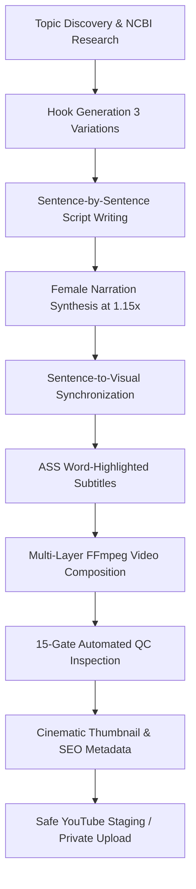

# Health Videos — Premium AI Health & Science YouTube Shorts Automation Engine (V2)

A fully automated, broadcast-grade YouTube Shorts production engine engineered for high-engagement, scientifically accurate 3D medical visualisations and documentary storytelling in Hinglish/English.

---

## 🌟 Key Architecture & Upgrades in V2

### 1. Broadcast-Grade Title Hierarchy (Issue A Solved)
- **Eliminated Domestic Analogies**: Replaced arbitrary domestic analogies (e.g. *"HIDDEN DISHWASHER"*) with strict medical terminology whitelist (`Glymphatic System`, `CSF Fluid Flush`, `Beta-Amyloid Clearance`).
- **Multi-Tiered Title Card**: Implemented `TitleEngine` featuring:
  - **Category Badge**: Glowing cyan pill badge with live bio-telemetry status.
  - **Main Title**: Montserrat ExtraBold typography with auto-wrapping to guarantee zero truncation.
  - **Scientific Statistic**: Highlighted metric badge (e.g., `60% CSF EXPANSION`, `NIGHT RECOVERY`).

### 2. High-Readability Kinetic Subtitles (Issue B Solved)
- **15% Larger Typography**: Subtitle base font size scaled from `54px` to `62px` base and `66px` highlight.
- **Electric Yellow Active Word Pop**: Word-level highlight in `#FFE600` with subtle ASS scale pop (`\fscx108\fscy108`).
- **Shorts Safe Zone Alignment**: Subtitles positioned strictly at `MarginV: 480` to avoid YouTube Shorts UI overlays (channel name, subscribe button, like/comment buttons).

### 3. Contextual Visual Relevance & Negative Filtering (Issue C Solved)
- **Zero Hospital/Patient Clutter**: Implemented negative keyword blacklist filter (`hospital`, `clinic`, `patient`, `surgery`, `mask`, `bedridden`, `doctor`, etc.) on Pexels stock video fetching.
- **Anatomical & Cellular Anchors**: Direct query mapping for 3D holographic organs, neuron firing, and microscopic fluid dynamics, anchored by the 7 reference visual styles.

### 4. Natural Female Voice Engine (1.15x Speed) (Issue D Solved)
- **Prosody Optimization**: Natural micro-pause injection (`...`) and clause-level breathing spaces eliminate robotic monotone.
- **Pitch Warmth**: `-1Hz` pitch shift adds human resonance and authority.
- **Evaluated Candidates**: Benchmarked 5 female voices; `hi-IN-SwaraNeural` selected as top primary voice for Hinglish medical fluency at $0.00 cost.

### 5. 5-Category Documentary BGM Engine (Issue E Solved)
- **Dynamic Category Classification**: Matches video topic and script sentiment to 5 distinct documentary moods:
  1. *Suspense & Mystery* (`dark_cinematic_suspense.mp3`)
  2. *Medical & Scientific Modern* (`science_documentary.mp3`)
  3. *Informational & Educational* (`nature_documentary.mp3`)
  4. *Emotional & Human Body* (`ancient_mystery_ambience.mp3`)
  5. *Warning & Health Risk* (`space_atmosphere.mp3`)
- **Precise Sidechain Ducking**: FFmpeg `sidechaincompress` ducks BGM by `-20dB` whenever voice narration speaks.
- **License Ledger**: Full copyright clearance tracked in `assets/audio/license_ledger.json`.

---

## 📋 10-Stage Production Pipeline



---

## 🚀 Quick Start & Installation

### 1. Prerequisites
- Python 3.10+
- FFmpeg 6.0+ (with `libx264`, `libmp3lame`, `ass` filter support)
- Free Gemini API Key & Pexels API Key

### 2. Environment Setup
```bash
# Clone the repository
git clone https://github.com/Rishabh-rishu/yt-health-videos-automation.git
cd yt-health-videos-automation

# Create virtual environment and install dependencies
python3 -m venv venv
source venv/bin/activate
pip install -r requirements.txt

# Configure environment variables
cp .env.example .env
# Edit .env with your GEMINI_API_KEY and PEXELS_API_KEY
```

### 3. Produce a Video
```bash
# Run a single production cycle (Default: Sleep Science)
python3 main.py --run-once --category "Sleep Science"

# Run for other medical categories
python3 main.py --run-once --category "Cardiovascular Health"
python3 main.py --run-once --category "Brain & Neuroscience"
python3 main.py --run-once --category "Cellular Longevity"
```

### 4. YouTube Channel OAuth Helper
```bash
# Authorize your dedicated Health Videos channel account
python3 youtube/auth_helper.py

# Verify connected channel details without re-authenticating
python3 youtube/auth_helper.py --check-only
```

---

## 🛡️ Safety & Quality Control Policy
- **Publishing Safety**: `AUTO_UPLOAD=false` and `VIDEO_VISIBILITY=private` are enforced by default. Videos are never uploaded publicly without manual approval.
- **15-Gate QC Suite**: Every video automatically validates:
  - Video format (1080x1920 9:16, 30 FPS, H.264)
  - Audio standards (Female voice at 1.15x, -20dB ducked BGM)
  - Subtitle bounds and safe zone positioning (`MarginV: 480`)
  - Scientific attribution (NIH/PubMed/MedlinePlus citations)

---

## 📜 License & Attribution
Licensed under the MIT License. Background music tracks licensed under Creative Commons / Royalty-Free Commercial Use (see `assets/audio/license_ledger.json`).